# 风格图鉴 · style-atlas

给 AI agent 用的视觉风格库，一共 70 种风格。做 App、网页、视频、海报、PPT 时，跟 Claude Code 或 Codex 说一句「用浮世绘风格」，它会读这种风格的规格，原样抄色值和字体，用现成的代码处理图片，做完截图和标准图对一遍。

让 AI 自己做界面，做出来常常是同一个样子：米白底、白卡片、圆角、一个强调色。这套库把每种风格写成能照着做的规则和代码，换风格时不用靠形容词碰运气。

[在线看 70 种（手机也能打开）](https://wailii.github.io/style-atlas/gallery/) · [安装](#安装) · [风格清单](#风格清单)

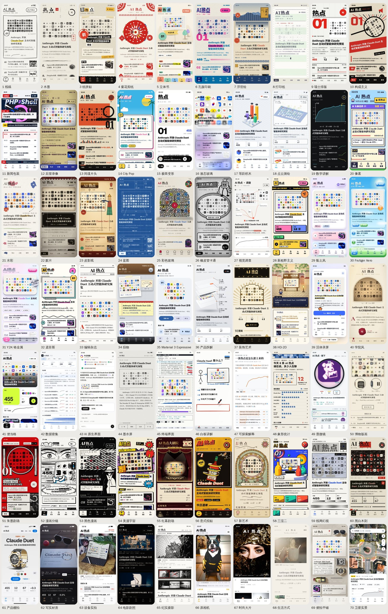

同一份数据（2026 年 10 月 22 日晚的 AI 热点热榜，8 条新闻和 4 张封面）按 70 种风格各做了一遍。每个参考页都是 390×844 的手机页面，按钮和列表都能点，在线版能看到动效。

## 安装

用 [skills](https://github.com/vercel-labs/skills) 命令安装，它会列出本机装了的 agent（Claude Code、Codex、Cursor 等），选要装到哪几个：

```bash
npx skills add wailii/style-atlas -g
```

也可以直接克隆到 agent 读 skill 的目录：

```bash
# Claude Code
git clone https://github.com/wailii/style-atlas.git ~/.claude/skills/style-atlas

# Codex，以及其他读 ~/.agents/skills 的 agent
git clone https://github.com/wailii/style-atlas.git ~/.agents/skills/style-atlas
```

更新时在目录里 `git pull`。截图验收要用本机的 Chrome 和 Node.js 22 以上；把视频页渲染成 MP4 还要 ffmpeg。

## 用法

装好以后直接跟 agent 说要做什么、用什么风格，比如：

- 用浮世绘风格做一个天气 App 的首页
- 做一条讲 Transformer 原理的竖屏短视频，先给我三四个风格挑
- 这个落地页太普通了，换成瑞士排版，头图借孔版印刷的处理
- 把产品发布会的 PPT 做成装饰艺术风格
- 做一个像那条 3D 滚动叙事视频一样炫的品牌落地页，再出一版 Dashboard
- 新品发布页要写实一点，像苹果官网那样的产品棚拍

agent 会按 [SKILL.md](SKILL.md) 里的步骤做：

1. 问清楚做的是什么、有没有真数据和真图
2. 用户点名了风格就用；没点名就按内容挑 3～4 个差别大的，做一个对比页让用户选
3. 读这种风格的规格 `styles/<id>.md`，再读 [media.md](media.md) 里对应媒介的一节
4. 色值、字体、参数从规格里原样复制；图片处理和招牌动效调用 `gallery/` 里现成的函数
5. 截图，和 `gallery/shots/<id>.png` 放在一起对：规格「一眼认出」里的每一条都要能在画面里找到

## 风格清单

70 种分 9 组。点风格名字可以在线打开它的参考页。要「炫」「电影感」时先看 [cinematic.md](cinematic.md)：从 70 种里挑出的 22 种，按网页、设计、Dashboard、视频、App 分好。要真实感时先看 [realistic.md](realistic.md)。

### 手作 · 手工艺

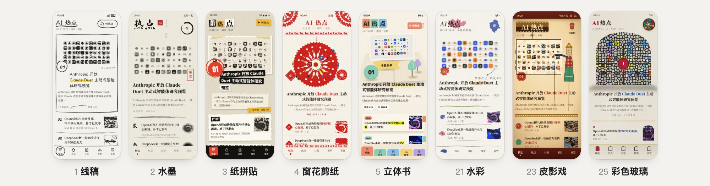

| # | 风格 | 样子 | 适合做 |
|---|---|---|---|
| 1 | [线稿](https://wailii.github.io/style-atlas/gallery/#lineart) | 白纸黑线，像一页随手画的笔记 | 读东西、学东西：知识卡片、日报、笔记、讲解视频 |
| 2 | [水墨](https://wailii.github.io/style-atlas/gallery/#ink) | 宣纸、墨色分层、一方红印 | 文化、阅读、节气、茶和书法类；纪录片片头 |
| 3 | [纸拼贴](https://wailii.github.io/style-atlas/gallery/#collage) | 剪报 + 网点照片 + 胶带，Vox 讲解片的样子 | 资讯、观点、杂志感强的内容；讲解视频 |
| 4 | [窗花剪纸](https://wailii.github.io/style-atlas/gallery/#papercut) | 一张红纸对折几次剪出来的窗花 | 节日、年货、红包活动、国风品牌 |
| 5 | [立体书](https://wailii.github.io/style-atlas/gallery/#popup) | 翻开这一页，纸片一层层立起来 | 儿童、绘本、旅行、礼物和贺卡 |
| 21 | [水彩](https://wailii.github.io/style-atlas/gallery/#watercolor) | 透明颜色一层层刷出来，旁边是手写注释 | 生活方式、旅行、植物、手账、温柔的品牌 |
| 23 | [皮影戏](https://wailii.github.io/style-atlas/gallery/#shadow) | 油灯照着的幕布，染色兽皮透出光 | 春节、非遗、戏曲、民俗、儿童故事 |
| 25 | [彩色玻璃](https://wailii.github.io/style-atlas/gallery/#stainedglass) | 真图切成彩色玻璃，铅条隔开，阳光扫过 | 节日、文化、高端品牌、仪式感的页面 |

### 印刷 · 版画

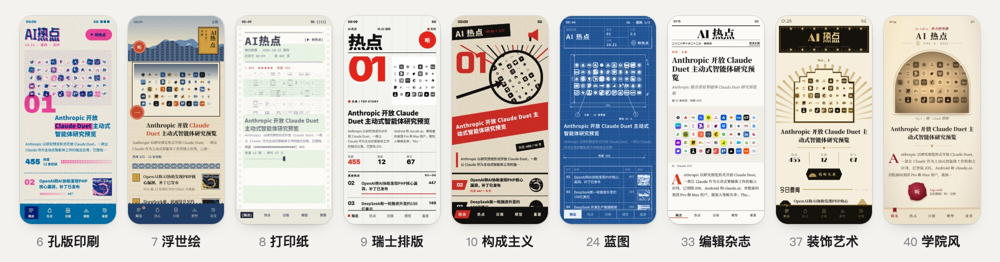

| # | 风格 | 样子 | 适合做 |
|---|---|---|---|
| 6 | [孔版印刷](https://wailii.github.io/style-atlas/gallery/#riso) | 只有蓝和荧光粉两种油墨，叠出来是紫的 | 年轻、潮、活动和社区类 |
| 7 | [浮世绘](https://wailii.github.io/style-atlas/gallery/#ukiyo) | 普鲁士蓝的浪、木版平涂、竖排题签 | 日式、旅行、餐饮、文化品牌 |
| 8 | [打印纸](https://wailii.github.io/style-atlas/gallery/#print) | 针式打印机的绿杠连续纸，封面打成字符画 | 开发者工具、日志、账单、复古小票 |
| 9 | [瑞士排版](https://wailii.github.io/style-atlas/gallery/#swiss) | 六栏网格、巨大编号、黑白加一点红 | 数据、金融、设计工作室、官网 |
| 10 | [构成主义](https://wailii.github.io/style-atlas/gallery/#constructivist) | 红黑斜线、大箭头、圆形照片蒙太奇 | 号召、活动、观点和宣言类内容 |
| 24 | [蓝图](https://wailii.github.io/style-atlas/gallery/#blueprint) | 晒图纸：蓝底白线、尺寸线、标题栏 | 硬件、工程、架构说明、产品原理页 |
| 33 | [编辑杂志](https://wailii.github.io/style-atlas/gallery/#editorial) | 报头大字、红色栏目名、首字下沉、居中引语、满幅大图 | 长文、专题、品牌故事、年报 |
| 37 | [装饰艺术](https://wailii.github.io/style-atlas/gallery/#deco) | 黑、金、象牙；光芒、阶梯拱门、灯泡跑马灯，一切从中轴展开 | 酒店、珠宝、颁奖、周年庆、高端邀请 |
| 40 | [学院风](https://wailii.github.io/style-atlas/gallery/#academia) | 羊皮纸、拱顶老照片、红色首字、目录卡抽屉、火漆按钮 | 读书、课程、研究机构、博物馆、出版社 |

### 影像 · 屏幕

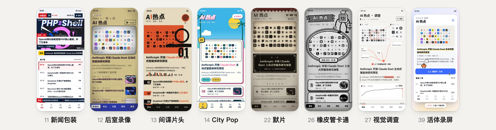

| # | 风格 | 样子 | 适合做 |
|---|---|---|---|
| 11 | [新闻包装](https://wailii.github.io/style-atlas/gallery/#news) | 台标、LIVE、下三分之一字幕、滚动条 | 资讯、赛事、直播、发布会 |
| 12 | [后室录像](https://wailii.github.io/style-atlas/gallery/#liminal) | 发黄的日光灯房间，透过一台老摄像机看 | 悬疑、游戏、恐怖、怪谈内容；万圣节活动 |
| 13 | [间谍片头](https://wailii.github.io/style-atlas/gallery/#spy) | 60 年代片头：橙色色块、黑条、爵士鼓点 | 影视、音乐、活动海报、品牌片头 |
| 14 | [City Pop](https://wailii.github.io/style-atlas/gallery/#citypop) | 80 年代动画：蓝天、椰子树、泳池、平涂描线 | 音乐、度假、潮牌、夏日活动 |
| 22 | [默片](https://wailii.github.io/style-atlas/gallery/#silent) | 1920 年代默片拷贝：闪、晃、划痕、字幕卡 | 历史、复古、品牌故事、文化活动 |
| 26 | [橡皮管卡通](https://wailii.github.io/style-atlas/gallery/#rubberhose) | 1930 年代黑白卡通：水管胳膊、白手套、跟着音乐跳 | 儿童、游戏、复古活动、吉祥物导览 |
| 27 | [视觉调查](https://wailii.github.io/style-atlas/gallery/#investigation) | 调查报道工作台：证据、来源连线、红色只用来指 | 事实核查、复盘、调查报道、竞品分析 |
| 39 | [活体录屏](https://wailii.github.io/style-atlas/gallery/#screencast) | 像一段产品录屏：光标是用户，像素小家伙替软件干活 | 产品演示、功能介绍、更新日志、引导页 |

### 数字 · 三维

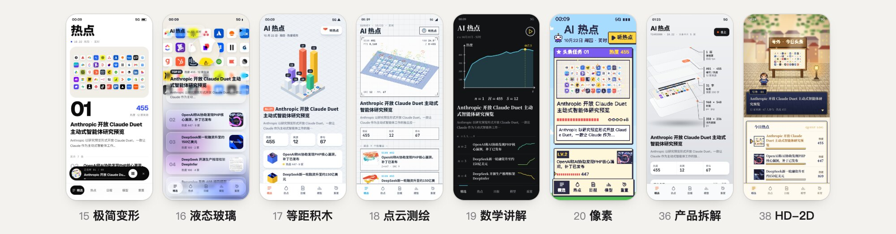

| # | 风格 | 样子 | 适合做 |
|---|---|---|---|
| 15 | [极简变形](https://wailii.github.io/style-atlas/gallery/#morph) | 大字、留白、一个会变形的黑色元素 | 工具、播放器、要显得专业的产品 |
| 16 | [液态玻璃](https://wailii.github.io/style-atlas/gallery/#glass) | 一层会折射的玻璃浮在真图上面 | 系统级工具、音乐、相机、手机桌面组件 |
| 17 | [等距积木](https://wailii.github.io/style-atlas/gallery/#iso) | 8 条热点堆成一座热度城市 | 数据看板、游戏化、教育、城市和地产 |
| 18 | [点云测绘](https://wailii.github.io/style-atlas/gallery/#lidar) | 封面变成一团会转的 3D 点云 | 科研、地图、汽车、硬件、工程类 |
| 19 | [数学讲解](https://wailii.github.io/style-atlas/gallery/#manim) | 3Blue1Brown 的样子：深底、坐标轴、会变形的曲线 | 教育、数据讲解、研究报告 |
| 20 | [像素](https://wailii.github.io/style-atlas/gallery/#pixel) | 16-bit 游戏的白天关卡，热点是任务 | 打卡、习惯、游戏化 |
| 36 | [产品拆解](https://wailii.github.io/style-atlas/gallery/#teardown) | 把卡片拆成五层浮起来，引线标着真实数字，镜头一直绕 | 硬件、SaaS 架构、产品功能讲解 |
| 38 | [HD-2D](https://wailii.github.io/style-atlas/gallery/#hd2d) | 像素小人站在有光有雾的立体小镇里，对话框逐字打出头条 | 游戏、文旅、城市导览、故事型落地页 |

### 界面潮流

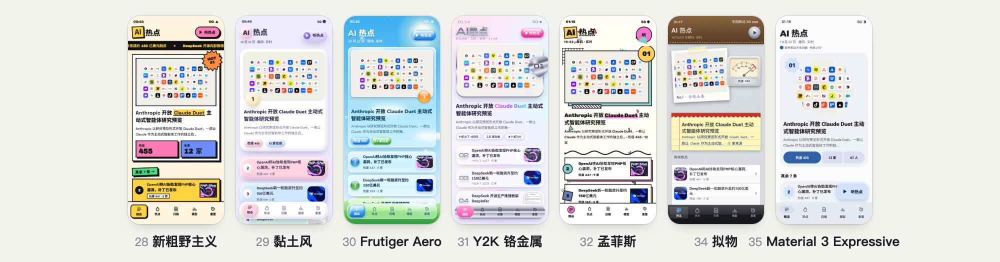

| # | 风格 | 样子 | 适合做 |
|---|---|---|---|
| 28 | [新粗野主义](https://wailii.github.io/style-atlas/gallery/#neubrutal) | 黑粗边、实心黑影、高饱和色块、歪着的贴纸 | 年轻、创作者、工具、活动页 |
| 29 | [黏土风](https://wailii.github.io/style-atlas/gallery/#clay) | 软黏土捏出来的界面：鼓、圆、糖果色 | 儿童教育、健康、轻松的消费产品 |
| 30 | [Frutiger Aero](https://wailii.github.io/style-atlas/gallery/#aero) | 蓝天草地、水晶气泡、Aqua 按钮、带倒影的图 | 饮料、户外、怀旧活动、年轻消费品牌 |
| 31 | [Y2K 铬金属](https://wailii.github.io/style-atlas/gallery/#y2k) | 液态铬、镭射彩虹、果冻胶囊按钮、到处闪的星光 | 潮牌、音乐、美妆、年轻人活动页 |
| 32 | [孟菲斯](https://wailii.github.io/style-atlas/gallery/#memphis) | 粗黑描边、糖果色几何碎片满屏飘、色块错位叠在后面 | 活动页、潮流品牌、设计周、儿童产品 |
| 34 | [拟物](https://wailii.github.io/style-atlas/gallery/#skeuo) | iOS 6 的真实材质：亚麻、缝线皮革、金属旋钮、拍立得、便签 | 复古工具、音频软件、怀旧专题、手账 |
| 35 | [Material 3 Expressive](https://wailii.github.io/style-atlas/gallery/#m3) | 配色从封面取、曲奇花朵形状、按下的按钮变宽、全是弹簧 | 安卓产品、工具、内容平台、多主题内容 |

### 工具界面

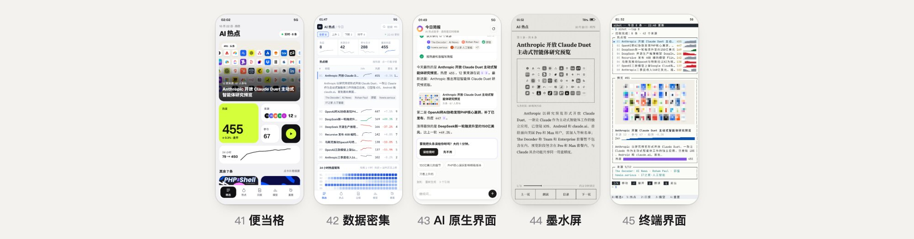

| # | 风格 | 样子 | 适合做 |
|---|---|---|---|
| 41 | [便当格](https://wailii.github.io/style-atlas/gallery/#bento) | 4 列小方格，每格一个能独立看懂的小部件 | SaaS / 工具首页、仪表盘首页、年度总结 |
| 42 | [数据密集](https://wailii.github.io/style-atlas/gallery/#dense) | 小字、等宽数字、行内曲线、24 小时矩阵、⌘K 搜索 | 后台、监控、交易、运营看板 |
| 43 | [AI 原生界面](https://wailii.github.io/style-atlas/gallery/#agent) | 智能体干活的过程：步骤打勾、来源冒出来、回答逐字流、动手前先问 | 任何「让 AI 帮你做事」的产品 |
| 44 | [墨水屏](https://wailii.github.io/style-atlas/gallery/#eink) | 纸灰底、16 级灰抖动图、翻页黑白闪一下、留一点残影 | 长文阅读、文档、专注模式、桌面小摆件 |
| 45 | [终端界面](https://wailii.github.io/style-atlas/gallery/#tui) | 浅色终端里的文字程序：框线、字符曲线、半格字符画的封面 | 开发者工具、CLI 产品、极客个人站 |

### 科普讲解

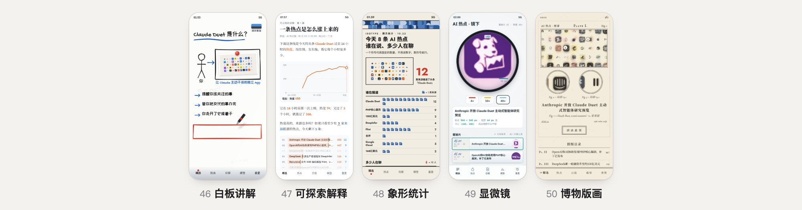

| # | 风格 | 样子 | 适合做 |
|---|---|---|---|
| 46 | [白板讲解](https://wailii.github.io/style-atlas/gallery/#whiteboard) | 马克笔当面一笔笔写、一笔笔画，照片用磁铁吸在板上 | 产品原理、课程、新手引导、科普视频 |
| 47 | [可探索解释](https://wailii.github.io/style-atlas/gallery/#explorable) | 正文里的数字能拖，图能拖，拖了句子和图一起变 | 科普长文、产品原理、计算器、教程 |
| 48 | [象形统计](https://wailii.github.io/style-atlas/gallery/#isotype) | 一个符号代表固定数量，数符号就懂，不满一个就切掉一截 | 科普数据、年报、公益、人口资源话题 |
| 49 | [显微镜](https://wailii.github.io/style-atlas/gallery/#microscope) | 圆形视野、染色标本、换物镜失焦再对焦，读数都是算出来的 | 科学、医疗、材料、芯片科普；放大看细节 |
| 50 | [博物版画](https://wailii.github.io/style-atlas/gallery/#engraving) | 铜版画：色调全靠线，刻完再上一层淡水彩，带编号和局部放大 | 博物馆、自然科普、百科、出版 |

### 电影 · 漫画叙事

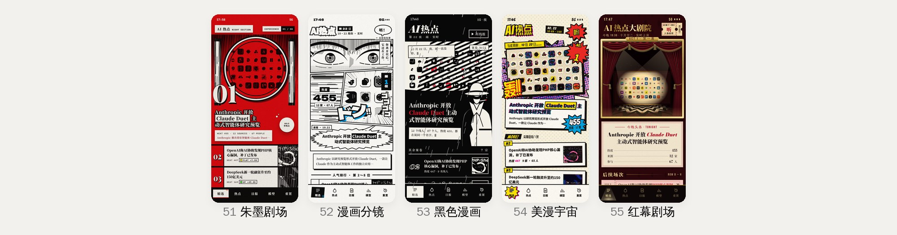
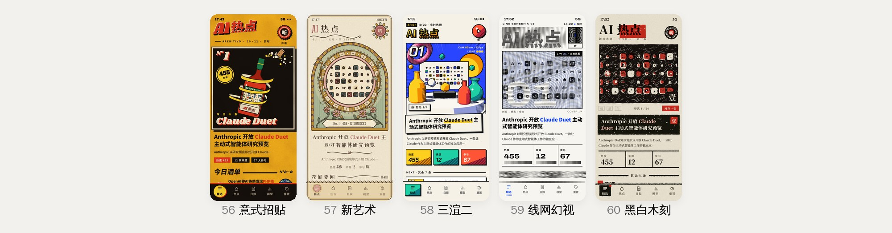

这 10 种都来自同一条视频：抖音 @Motdes AI阿峰《fable 5.5 网页设计的未来？》录屏的 *The Notturno Experience*，一个意大利开胃酒品牌的 3D 滚动叙事网页。朱墨剧场是视频本身的设计语言，另外 9 种是从里面拆出来、各自往一个方向走到头的风格。

| # | 风格 | 样子 | 适合做 |
|---|---|---|---|
| 51 | [朱墨剧场](https://wailii.github.io/style-atlas/gallery/#crimson) | 朱红、纸白、墨黑，明暗全是竖排墨线；一幕幕滴落转场，关键动作要按住 | 品牌发布、酒饮美妆、滚动叙事落地页、夜场感数据大屏 |
| 52 | [漫画分镜](https://wailii.github.io/style-atlas/gallery/#manga) | 斜切分格、网点纸、集中线、瞪大的眼睛、压过格线的拟声字 | 剧情感强的发布、榜单、番剧和游戏活动 |
| 53 | [黑色漫画](https://wailii.github.io/style-atlas/gallery/#noir) | 雨夜、百叶窗影子、纯黑白，只有一种红 | 悬疑、调查、安全事件、深夜栏目 |
| 54 | [美漫宇宙](https://wailii.github.io/style-atlas/gallery/#comicverse) | 四色网点套不准、粗墨线、一拍二地跳、故障帧 | 游戏、潮牌、音乐体育活动、短视频片头 |
| 55 | [红幕剧场](https://wailii.github.io/style-atlas/gallery/#stage) | 镀金台口、丝绒大幕拉开、追光落在主角上、戏票撕票根 | 发布会、首映、演出票务、颁奖揭晓 |
| 56 | [意式招贴](https://wailii.github.io/style-atlas/gallery/#affiche) | 一块平色底，酒瓶从黑里跳出来开瓶，手绘大字带投影 | 酒饮、餐饮、快消新品、复古品牌海报 |
| 57 | [新艺术](https://wailii.github.io/style-atlas/gallery/#nouveau) | 慕夏：大圆光环、鞭线藤蔓长出来、花边拱框 | 美妆、香水、花艺、茶饮、书封 |
| 58 | [三渲二](https://wailii.github.io/style-atlas/gallery/#celshade) | 真 3D 渲染成动画：三段硬光、黑墨描边、暗部排线 | 游戏、动画、潮牌、新品主视觉 |
| 59 | [线网幻视](https://wailii.github.io/style-atlas/gallery/#opart) | 图只用平行线画，两层线叠出摩尔纹，画面碎成竖条往下滴 | 音乐、艺术展、时装、发布会 |
| 60 | [黑白木刻](https://wailii.github.io/style-atlas/gallery/#linocut) | 白是刀挖出来的，墨有白点，套一块错位的朱红版 | 人文、历史、纪录片、出版、节日海报 |

朱墨剧场除了手机参考页，还有两种媒介的完整参考：

- `gallery/x-crimson.html`：桌面滚动叙事体验（虚构品牌 MEZZANOTTE），8 幕，真 3D 场景经过墨线后期着色器变成竖排线；滚轮、按住、方向键都能推进，也会自动播放。带 `seek(t)`，能直接渲染成 46 秒 1920×1080 视频
- `gallery/d-crimson.html`：Dashboard。面积图用竖排线填，柱子是红色多立克柱，环形图是圆窗，数字全部来自 `data.js`

```bash
node tools/snap.mjs --file gallery/x-crimson.html --video mezzanotte.mp4 --w 1920 --h 1080 --scale 1 --fps 30
```

### 写实 · 影像

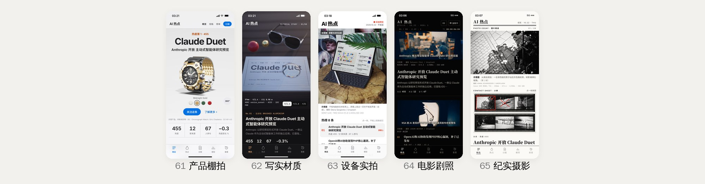
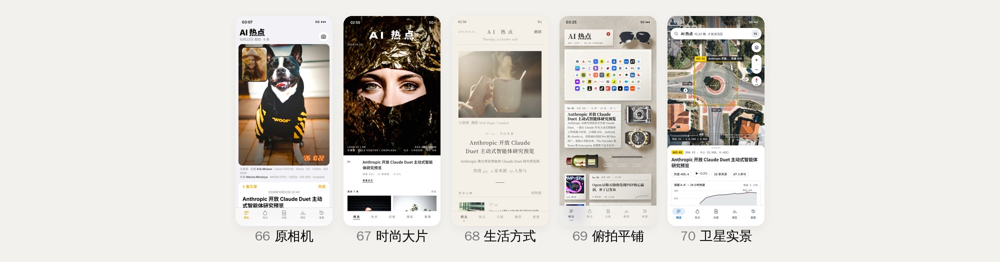

前 60 种都是画出来的风格，这一组补的是写实：真照片、真实材质的 3D、真镜头。照片来自 Unsplash（经 Hugging Face 镜像），带真实 EXIF；3D 是 Khronos 的 PBR 示例模型配 Poly Haven HDRI，在浏览器里实时渲染。页面上的图库照片都标「示意图 · 摄影师」，和新闻内容无关。

| # | 风格 | 样子 | 适合做 |
|---|---|---|---|
| 61 | [产品棚拍](https://wailii.github.io/style-atlas/gallery/#studio) | 浅灰背景纸、柔光箱、真 3D 产品带贴地阴影、大标题和规格大数字 | 硬件发布、电商详情、品牌官网首屏 |
| 62 | [写实材质](https://wailii.github.io/style-atlas/gallery/#render) | 拉丝铝铭牌刻字、玻璃透镜折射、HDRI 反射、浅景深 | 高端品牌、腕表珠宝、工业设计 |
| 63 | [设备实拍](https://wailii.github.io/style-atlas/gallery/#device) | 真照片里的屏幕透视贴上你的界面，带反光和遮挡 | App 宣传、App Store 截图、落地页 |
| 64 | [电影剧照](https://wailii.github.io/style-atlas/gallery/#filmstill) | 2.39:1、橙青调色、颗粒光晕、烧录字幕 | 品牌短片、影评、播客、长读 |
| 65 | [纪实摄影](https://wailii.github.io/style-atlas/gallery/#documentary) | 大幅黑白照片、长图说带 EXIF、红笔圈过的底片小样 | 深度报道、年报、公益记录 |
| 66 | [原相机](https://wailii.github.io/style-atlas/gallery/#rawcam) | 闪光灯直打、前摄小窗、橙色 LED 日期、备忘录配文 | 社媒、日记、活动回顾 |
| 67 | [时尚大片](https://wailii.github.io/style-atlas/gallery/#campaign) | 满幅硬光人像、超宽字标、9px 小字 | 时尚、美妆、奢侈品 |
| 68 | [生活方式](https://wailii.github.io/style-atlas/gallery/#lifestyle) | 窗光真照片、胶片暖调、细衬线、宽边距 | 家居、咖啡、订阅、品牌故事 |
| 69 | [俯拍平铺](https://wailii.github.io/style-atlas/gallery/#flatlay) | 正上方拍桌面，物件按网格摆，真影子 | 电商、开箱、文具数码 |
| 70 | [卫星实景](https://wailii.github.io/style-atlas/gallery/#satellite) | 真航拍地图，黄框关注区、尺寸线、剖面、网格坐标 | 地理、物流、城市、调查报道 |

## 规格结构

每种风格一份规格 `styles/<id>.md`，小节是固定的：

| 小节 | 写什么 |
|---|---|
| 直接抄 | CSS 变量、字体链接、调色板、关键参数，复制过去就能用 |
| 一眼认出（不能改） | 3～5 条特征，验收时逐条在画面里找 |
| 颜色、字体 | 每个色值和字重，哪些可以改、哪些一改就不像了 |
| 真图怎么处理 | 照片进来变成什么样，调哪个函数、传什么参数 |
| 动效 | 进场动画、常驻动画、点击反馈的时长和写法 |
| 组件 | 主按钮、主卡、列表、底栏怎么做 |
| 换到别的东西上 | 落到网页、视频、海报上时改哪些 |
| 容易做坏 | 常见的走样和对应的改法 |
| 参考实现 | 参考页里对应的函数名 |

部分风格还有「底和纹理」「线和形」两节。下面是浮世绘「直接抄」一节的原文：

```css
:root { --paper:#f1e6cd; --blue:#22406b; --blue2:#6c8db3; --pale:#c9d8df; --red:#cc4a2c; --ochre:#d8a443; --ink:#1d1b19; }
@import url("https://fonts.googleapis.com/css2?family=Noto+Serif+SC:wght@500;700;900&display=swap");
.cart { writing-mode: vertical-rl; background: var(--ochre); border: 2px solid var(--ink); box-shadow: inset 0 0 0 3px var(--ochre), inset 0 0 0 4px var(--ink); }
```

```js
UKIYO = ["#1d1b19","#22406b","#6c8db3","#c9d8df","#f1e6cd","#f6eedb","#cc4a2c","#d8a443","#8a6d48"]
posterCanvas(img, W, H, UKIYO, { edge:.22, soft:4 })
crest(x,t) = 62 + 16·sin(x/46 + t) + 7·sin(x/19 − 1.4t) + 4·sin(x/9 + 2.1t)   // 浪
```

## 真图处理

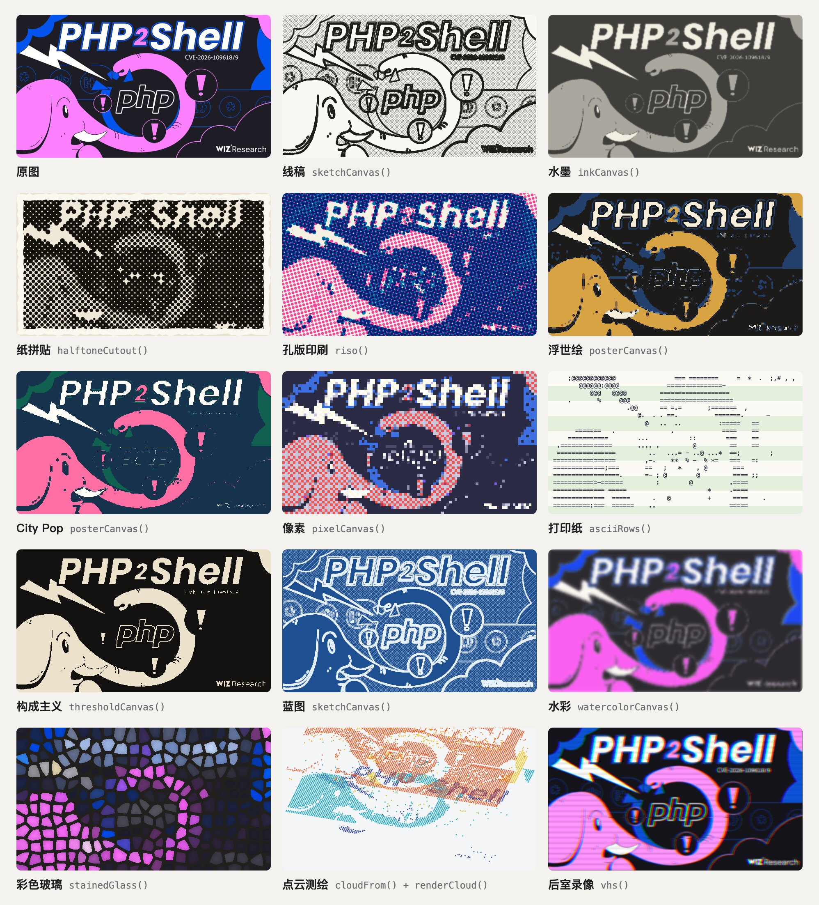

同一张新闻封面，经过 14 种风格的处理函数。这些函数都是浏览器里的 canvas 代码，放在 `gallery/common.js` 和 `gallery/engines.js`，不调用生图模型，也不需要后端。每个函数的参数见 [ENGINES.md](ENGINES.md)。

## 动效

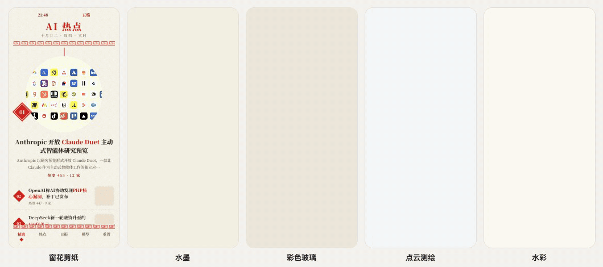

参考页打开后前 5 秒的录屏：窗花一折折展开，墨从一点晕开，彩色玻璃一块块亮起来，点云被激光扫出来，水彩一层层刷上去。每份规格的「动效」一节写了时长、缓动和帧率，定格类风格按 8～12 帧/秒走，顺滑类用弹簧或 smooth 曲线。

## 视频

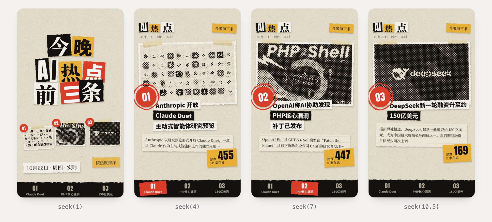

`gallery/v-collage.html` 是一条 12 秒、1080×1920 的纸拼贴竖屏视频。页面提供 `seek(t)`，每一帧只由时间 t 决定，所以能逐帧截图、直接渲染成 MP4：

```bash
node tools/snap.mjs --file gallery/v-collage.html --video out.mp4 --w 1080 --h 1920 --scale 1 --fps 24
```

用别的风格做视频，照 [media.md](media.md) 视频一节的骨架改。

## 混搭

两种风格可以拼着用：一种定底、颜色和字体，另一种只借一到两层（真图处理、线和形、节奏、反馈）。[mixing.md](mixing.md) 里有规则和试过的组合，例如：

| 底 | 借 | 效果 |
|---|---|---|
| 瑞士排版 | 孔版印刷的蓝粉双色网点图 | 网格海报，图有印刷感 |
| 极简变形 | 点云测绘的头图 | 产品发布感，头图会转 |
| 水墨 | 窗花剪纸的红色小图标 | 节日版的国风 |

## 验收工具

```bash
# 截图：自动起本地服务，等动画跑完再截
node tools/snap.mjs --file 你的页面.html out.png --wait 7000

# 检查每种风格的规格、参考页、标准截图、目录项是否齐全
node tools/check.mjs
```

`snap.mjs` 还能 `--click` 截点击后的样子、`--frames` 给视频页抽帧。本地看全部参考页：`python3 -m http.server 8960 -d gallery`，浏览器打开 `http://localhost:8960`。

## 目录结构

```
SKILL.md          agent 读的入口：风格目录、选风格的办法、工作步骤
styles/<id>.md    70 份风格规格
realistic.md      写实精选：10 种写实风格怎么用、素材从哪来、怎么不造假
cinematic.md      炫酷精选：22 种冲击力最强的风格，按网页 / 设计 / Dashboard / 视频 / App 分好
media.md          落到 App、网页、视频、动画、海报时怎么改
mixing.md         混搭规则
ENGINES.md        图片处理和动效函数的用法
DATA.md           参考页的数据格式，怎么换成自己的内容
gallery/          参考页 s-<id>.html、视频参考 v-collage.html、朱墨剧场体验页 x-crimson.html 和 Dashboard d-crimson.html、共用代码、标准截图 shots/
tools/            截图工具 snap.mjs、完整性检查 check.mjs
```

## 出处

每种风格的来源写在规格开头和 `gallery/styles.js` 里，主要有：

- [lemo-opuscar](https://github.com/lemomo-ai/lemo-opuscar)（MIT）：31 种风格参考了它的风格库
- [UI/UX Pro Max](https://github.com/nextlevelbuilder/ui-ux-pro-max-skill)（MIT）：14 种风格参考了它的风格表
- WY（[@akokoi1](https://x.com/akokoi1)）用 Opus 5.5 做的线稿、水墨等代码动画
- 各风格规格里列出的视频提示词、skill 仓库和设计文章

`gallery/vendor/rough.js` 是 [Rough.js](https://github.com/rough-stuff/rough)（MIT）。示例数据取自 2026 年 10 月 22 日晚的 AI 热点热榜，`gallery/img/` 里的封面图版权归原发布方。

## 许可

[MIT](LICENSE)。`gallery/img/` 里的示例封面图不在许可范围内。
